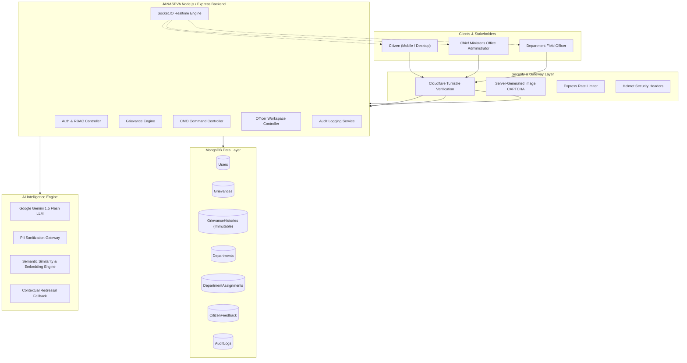

# 02. System Architecture – JANASEVA AI

## 1. Architectural Philosophy
JANASEVA AI utilizes a **Modular Monolithic Architecture**. Instead of premature microservices that introduce distributed transaction failures and high deployment friction, the platform organizes clean domain boundaries into decoupled layers:
- **Presentation Layer (Frontend):** Next.js (React 18), Tailwind CSS, Framer Motion, Recharts.
- **Application & API Layer (Backend):** Node.js, Express.js (ES Modules), Socket.IO, Zod validation, JWT security.
- **Persistence Layer (Database):** MongoDB with Mongoose ODM, secondary indexes, aggregation pipelines.
- **Intelligence Layer (AI Engine):** Google Gemini API (`@google/generative-ai`), text embeddings, contextual fallback engine.
- **Defense & Integrity Layer (Security):** Dual-Layer CAPTCHA (Cloudflare Turnstile + SVG CAPTCHA), Helmet, Rate limiting, Audit logging.

---

## 2. System Architecture Diagram

---

## 3. Layer Breakdown

### A. Frontend Presentation Layer
- **Framework:** Next.js (Page Router), strictly JavaScript (`.js`, `.jsx`). Zero TypeScript files.
- **Styling & Design System:** Tailwind CSS customized with the Kerala Government civic color scheme:
  - Deep Government Green (`#0F4336`)
  - Royal Amber / Gold (`#D97706`, `#F59E0B`)
  - Crisp Slate Neutral backgrounds (`#F8FAFC`, `#0F172A`)
- **State Management & Contexts:**
  - `AuthContext`: Tracks JWT token, user roles, automatic redirection, session expiry.
  - `LanguageContext`: Seamless toggling between English and Malayalam (മലയാളം).
- **Data Visualization:** Recharts rendering dynamic district-wise distribution, department workloads, and 6-month resolution trends.

### B. Application & API Layer (Backend)
- **Runtime:** Node.js (v24.x LTS) with native ES Modules (`"type": "module"`).
- **REST Framework:** Express.js providing strictly structured endpoints under `/api/*`.
- **Validation:** Zod schemas and Mongoose model validations preventing malformed payloads.
- **Real-Time Layer:** Socket.IO providing instant notification broadcasting across dedicated rooms (`user_{id}`, `cmo_admins`, `officers`).

### C. Intelligence Layer (Google Gemini)
- Minimized complaint text is sanitized of phone numbers and email addresses before reaching external AI APIs.
- Returns strict JSON schema containing:
  - `suggestedDepartment`: Mapped strictly to verified active departments.
  - `suggestedCategory`: Subcategory relevant to nodal operations.
  - `priority`: Urgent, High, Medium, or Low based on reported community hazard.
  - `summary`: Concise executive abstract for administrative review.
  - `reasoning`: Justification for department and priority determination.
  - `duplicateWarning`: Semantic flag if similar complaints exist in the same district.

### D. Security & Bot Prevention
- **Dual CAPTCHA Sequence:**
  1. Citizen completes Cloudflare Turnstile widget.
  2. Citizen solves server-generated Image CAPTCHA (single-use, 3-minute TTL).
  3. Server validates both layers before database queries or session token generation.
- **Audit Logging:** Every sensitive administrative event (department assignment, report review, escalation, reopen) is permanently written to the `AuditLog` collection.
