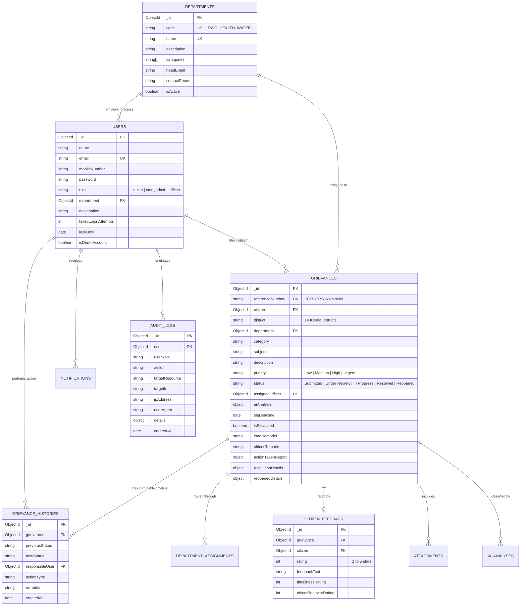

# 03. Database Design – JANASEVA AI

## 1. Overview
JANASEVA AI utilizes **MongoDB** with **Mongoose ODM**, structured to deliver high-concurrency civic performance, strict referential consistency, auditable historical tracing, and fast analytical aggregation queries across all 14 Kerala districts.

---

## 2. Database Entity-Relationship (ER) Diagram

---

## 3. Detailed Collections & Schema Specifications

### A. `Users` Collection
- **Indexes:**
  - `email`: Unique ascending index (`{ email: 1 }`, unique).
  - `role`: Secondary index for role-based queries (`{ role: 1 }`).
- **Security Protections:**
  - Passwords hashed using bcrypt with salt rounds of 10.
  - Password field omitted from JSON serialization (`select: false`).
  - Progressive account lockout: 5 failed attempts trigger a 15-minute lockout via `lockUntil`.

### B. `Departments` Collection
- **Indexes:**
  - `code`: Unique uppercase index (`{ code: 1 }`, unique).
  - `name`: Unique index (`{ name: 1 }`, unique).
- **Seeded Nodal Departments:**
  1. `PWD` – Public Works Department
  2. `HEALTH` – Health Department
  3. `EDU` – Education Department
  4. `WATER` – Water Resources Department
  5. `LSGD` – Local Self Government Department
  6. `KSEB` – Electricity Department
  7. `TRANS` – Transport Department
  8. `REV` – Revenue Department

### C. `Grievances` Collection
- **Indexes:**
  - `referenceNumber`: Unique alphanumeric index (`{ referenceNumber: 1 }`, unique).
  - `citizen`: Index for fast citizen dashboard loads (`{ citizen: 1 }`).
  - `department`: Index for officer assignment scoping (`{ department: 1 }`).
  - `status`: Index for state filtering (`{ status: 1 }`).
  - `district`: Index for geographical distribution queries (`{ district: 1 }`).
  - `slaDeadline`: Index for overdue breach detection (`{ slaDeadline: 1 }`).
- **SLA Computation:**
  - Automatic pre-save hook computes the target resolution deadline based on priority:
    - Urgent: 24 Hours
    - High: 48 Hours
    - Medium: 96 Hours
    - Low: 168 Hours

### D. `GrievanceHistories` (Immutable Lifecycle Chain)
- **Constraint:** Previous history entries are never overwritten or deleted.
- **Payload:** Records `previousStatus`, `newStatus`, `responsibleUser`, `actionType`, and `remarks`.

### E. `CitizenFeedback`
- **Ownership Constraint:** Only the authenticated citizen who created the grievance can submit feedback.
- **Workflow Constraint:** Feedback can only be submitted after the grievance reaches `Resolved` status.

### F. `AuditLogs`
- Records every administrative intervention (Department assignment, Escalations, Report Approvals, Logins).
- Captures remote IP address, user-agent string, and parameter diffs.
